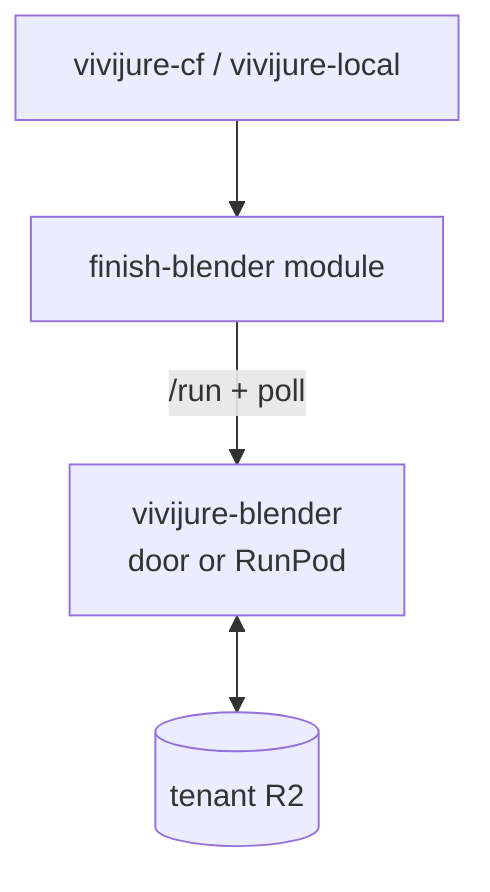

# Constellation: vivijure-blender

You are in a **finish helper engine**. The studio invokes the CF module `finish-blender`
(`MODULE_FINISH_BLENDER`); that module submits async jobs to this engine: a Cloudflare Container
door when `FINISH_BLENDER_DOORS` is set, else a RunPod endpoint.

Sibling finish engine: `vivijure-upscale`. (`vivijure-musetalk` and `vivijure-audio-upscale` are archived.)  
GPU render spine: `vivijure-backend`. CPU assemble: `video-finish` container (not this repo).
